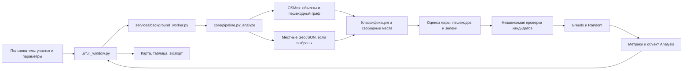

# HeatShield

Настольное приложение на Python для предварительного поиска мест посадки деревьев в реальных городах. Оно загружает здания, дороги, пешеходные пути, зелёные зоны, воду, деревья и точки притяжения из OpenStreetMap, строит геометрически свободные участки и сравнивает размещение деревьев методами Greedy и Random.

## Запуск на Windows 10/11

**Самый простой вариант:** дважды нажмите `START_HEATSHIELD.bat` в корне проекта. Он откроет собранный `dist\HeatShield\HeatShield.exe`. Внутри папки `dist\HeatShield` лежит такой же батник: можно запускать приложение оттуда. EXE нужно оставлять вместе с соседней папкой `_internal`.

Если хотите запускать именно исходники и окружение ещё не создано, дважды нажмите `SETUP_AND_RUN.bat`. Он установит зависимости через интернет и запустит `main.py`; для него нужен Python 3.11. После установки можно запускать `START_HEATSHIELD.bat`, даже если готового EXE нет.

Ручной способ: требуется Python 3.11+ и интернет для OSM. В PowerShell из корня проекта:

```powershell
py -3.11 -m venv .venv
.\.venv\Scripts\Activate.ps1
python -m pip install -r requirements.txt
python main.py
```

При запрете выполнения скриптов PowerShell можно запускать `.venv\Scripts\python.exe main.py` напрямую. Проверка кода: `.venv\Scripts\python.exe -m pytest -q`.

Разбор устройства проекта и порядок чтения исходников — в `LEARNING_GUIDE.md`. В собственных Python-файлах проекта строки снабжены русскими комментариями: они объясняют данные, единицы измерения и причины проверок.

## Как использовать

1. Во вкладке **Участок** найдите город, вставьте полную ссылку Google Maps, введите координаты или выделите прямоугольник на карте, удерживая **Shift**. После выделения прямоугольника поля широты и долготы показывают его центр. Если изменить их вручную, нажмите **Выбрать по координатам**: прежняя область и прежние результаты сбрасываются. При наличии местной инвентаризации загрузите GeoJSON с точками/линиями существующих деревьев и GeoJSON с полигонами запретных зон.
2. Выберите радиус 250, 500 или 1000 м. Максимальная площадь анализа — 4 км².
3. Во вкладке **Параметры** задайте количество деревьев (до 1800), бюджет, стоимость посадки, расстояние и приоритеты. Под полями сразу показано, сколько деревьев позволяет бюджет: при 150 деревьях по 10 000 ₸ нужно не меньше 1 500 000 ₸. После анализа появится число геометрических кандидатов. Фактический план может быть меньше из-за расстояний и процентной цели. В отдельной плашке задайте желаемый процент **новой условной тени от площади участка**. При 0% используется весь лимит деревьев.
4. Нажмите **Анализировать территорию**. Первый запрос к Overpass может занять несколько минут. Обработка идёт в фоне, интерфейс остаётся доступным.
5. Приложение откроет вкладку **Результаты** с таблицей Greedy и Random. Переключатель «После» находится над картой. Слои включаются кнопкой в правом верхнем углу карты. По умолчанию видны здания, зелень, вода, известные деревья и рекомендации; подробные линии, кандидаты и тепловой слой включаются отдельно. Клик по жёлтому кандидату позволяет добавить дерево, а зелёный маркер можно перетащить к другой жёлтой точке или убрать. Во время переноса кандидаты появляются автоматически. После переноса пересчитываются оценки; ограничения бюджета и расстояния проверяются повторно. Карточка точки показывает расстояния до размеченных зданий, дорог, воды, зелени и деревьев.
6. Измените веса во вкладке **Параметры** и нажмите **Повторить оптимизацию**, чтобы сравнить другой сценарий без повторной загрузки OSM. Повторный подбор выполняется в фоне, поэтому окно остаётся доступным при большом числе деревьев.
7. Во вкладке **Результаты** кнопка **Сохранить сценарий и экспорт** создаёт JSON сценария, GeoJSON рекомендованных точек, CSV кандидатов и PNG карт «до» и «после».

## Что означают результаты

- **Реальные данные:** геометрия и теги OSM, а при загрузке файлов — местные GeoJSON. Покрытие OSM неполное; отсутствие размеченного дерева не означает его отсутствия на месте. OSM помечает отдельное дерево `natural=tree`, ряд `natural=tree_row`, иногда группы `natural=tree_group` и озеленённые вдоль улиц пути `tree_lined=*`.
- **Процентная цель:** доля объединённой площади условных крон внутри выбранного участка. Радиус каждой кроны принят равным 7 м. Greedy останавливается, когда цель достигнута, либо закончился лимит деревьев или бюджет. Random получает такое же число деревьев для честного сравнения. Недостигнутая цель показывается прямо в интерфейсе. Это оценка будущей тени при допущении о размере крон, а не охлаждения воздуха.
- **Модельные оценки:** исходный относительный индекс тепловой нагрузки учитывает близость дороги, долю зданий, зелёных зон и размеченных деревьев в радиусе 60 м. «После» — сценарий с площадью условной тени и допущением о максимальном изменении индекса под кроной на 15%. Коэффициент **не откалиброван** по местным измерениям. Пешеходный индекс использует близость точек притяжения и условных маршрутов на пешеходном графе; доля дополнительной тени на пешеходной сети измеряется геометрически по её размеченной длине. Это не температура воздуха и не подсчёт прохожих.
- **Проверка рекомендаций:** перед показом плана выполняется отдельная проверка выбранных координат по зданиям, дорогам и велодорожкам, пешеходным путям, тротуарам, воде, зелени, деревьям, парковкам, стройкам, железнодорожным путям и импортированным запретным полигонам. При нарушении ограничений план не показывается. Отсутствие зелени в источниках даёт нейтральную оценку дефицита и предупреждение.
- **Предварительные рекомендации:** свободная геометрия исключает известные препятствия с защитными отступами. Тротуары, нарисованные отдельно в OSM, исключаются как пешеходные линии; тротуары, отмеченные только тегом дороги, защищены приближённым коридором 8 м вокруг её оси. Этот коридор не сообщает точную границу тротуара. Местные GeoJSON позволяют добавить точки существующих деревьев и полигоны известных запретов; формат координат — WGS84, порядок **долгота, широта**. Программа не определяет право собственности, подземные сети, грунт и местные нормы. Перед посадкой нужна выездная проверка.
- **Сравнение:** оба алгоритма используют одинаковую функцию пользы, ограничения и количество деревьев. Random воспроизводим при неизменном seed. Разница в процентах относится к условной функции пользы; если количество деревьев оказалось разным, процент сравнения не показывается.
- **Обучение:** текущая версия не обучена статистически. OSM даёт признаки среды, но не подтверждённые результаты посадок или измерения теплового комфорта для обучения. Обучение на искусственно назначенных «правильных местах» сделало бы результат недостоверным. Для следующей версии нужны полевые измерения, проверенные посадки и инвентаризация деревьев.

Коэффициенты исходного теплового индекса вынесены в `config.py`: базовый уровень 0,35, вес плотности зданий 0,45, близости дороги 0,20 и покрытия зеленью −0,35. Размеченное дерево рассматривается как условная зелёная область радиусом 5 м. Эти величины — открытые сценарные допущения для сравнения мест внутри одного района, а не обученные параметры или универсальная физическая формула.

## Источники и зависимости

Карта © [OpenStreetMap contributors](https://www.openstreetmap.org/copyright). Геометрия поступает через [OSMnx](https://osmnx.readthedocs.io/) из публичного Overpass API. В `config.py` задан публичный сервер из [списка OSM Wiki](https://wiki.openstreetmap.org/wiki/Overpass_API). Поиск города использует [Nominatim](https://nominatim.org/release-docs/latest/api/Search/). Google Maps используется только для определения координат. Leaflet 1.9.4 поставляется локально с лицензией в `ui/assets/LEAFLET_LICENSE.txt`. Схемы OSM для [тротуаров](https://wiki.openstreetmap.org/wiki/Sidewalks) и [рядов деревьев](https://wiki.openstreetmap.org/wiki/Tag:natural%3Dtree_row) описаны в документации сообщества.

Глобальная карта [ESA WorldCover](https://esa-worldcover.org/en) доступна с разрешением 10 м для 2020–2021 годов. Она может показать общий тип покрова, но её ячейка не устанавливает координату отдельного городского дерева или точное место посадки. Поэтому приложение не выдаёт её за реестр деревьев: для конкретного района используйте местную инвентаризацию GeoJSON и осмотр.

Публичные OSM сервисы иногда перегружены. Приложение показывает ошибку сети и не заменяет данные вымышленным городом. Кеш OSMnx хранится в `data/cache`.

В `examples/almaty/` лежит сохранённый сценарий на реальном участке Алматы (177 геометрических кандидатов и 20 предложенных деревьев). В этом сценарии новые условные кроны покрывают около 0,48% площади участка; сценарный индекс меняется примерно на 0,08%. Все 177 кандидатов прошли повторную проверку по известным объектам OSM. Сценарий можно открыть кнопкой **Открыть сохранённый сценарий** без нового запроса к Overpass. Файлы можно повторно получить командой `python -m examples.generate_almaty` при доступной сети.

Подробный разбор выбранных мест, сравнения с Random и ручных переносов находится в `VALIDATION.md`.

Исследования с полевыми измерениями показывают, что эффект тени деревьев зависит от конкретной улицы и условий, а влияние водоёмов меняется в течение суток ([уличная тень](https://doi.org/10.1016/j.heliyon.2024.e32762), [городской водоём](https://doi.org/10.1016/j.scs.2023.104407)). Поэтому вода используется как геометрическое ограничение и отображается в карточке точки, но ей не назначен универсальный «охлаждающий коэффициент».

## Архитектура: как проходит один анализ

Приложение состоит из трёх частей: `ui/` показывает окно и карту, `core/` считает геометрию и планы, `services/` выполняет долгие задачи в фоне и сохраняет результат. Основной язык — Python. Встроенная интерактивная карта использует небольшую HTML-страницу с Leaflet и JavaScript: это часть интерфейса, а не отдельный сервер.



Порядок действий внутри `core/pipeline.py`:

1. `load_city()` загружает OSM-объекты и пешеходный граф через OSMnx. Объекты описаны геометрией и тегами, например `building=yes` или `natural=tree`.
2. `classify()` раскладывает объекты по тематическим слоям. `merge_local_layers()` добавляет выбранные пользователем GeoJSON.
3. `find_free_space()` вычитает известные препятствия и защитные отступы, затем создаёт сетку возможных точек. По умолчанию шаг сетки — 30 м, максимум — 1800 кандидатов. Это предел поиска, а не обещание 1800 доступных мест.
4. `heat_scores()`, `pedestrian_scores()` и `green_deficit()` дают каждому кандидату три **условные** оценки. Они нужны, чтобы сравнить места внутри одного участка.
5. `audit_selection()` отдельно проверяет все кандидаты по известным геометриям. Если найдены нарушения, результат анализа не показывается.
6. `greedy()` выбирает точки по заданным весам, бюджету, расстоянию и цели затенения. `random_placement()` строит воспроизводимый контрольный вариант с тем же числом деревьев.
7. `compare()` считает стоимость, условную пользу, площадь новых крон, долю участка под ними и другие показатели. Готовый объект `Analysis` возвращается в окно.

Долгая загрузка и повторная оптимизация выполняются через `Worker` в пуле потоков Qt, поэтому окно не должно зависать. При ручном переносе дерева интерфейс привязывает маркер к ближайшему уже проверенному кандидату и заново проверяет ограничения.

### Какие данные передаются между файлами

| Имя | Где определено | Что хранит |
|---|---|---|
| `bounds` | Передаётся из `ui/full_window.py` | Четыре числа в градусах: **юг, запад, север, восток**. |
| `CityData` | `core/map_loader.py` | Границы участка, OSM-объекты, пешеходный граф и систему координат для расчётов в метрах. |
| `layers` | `core/city_builder.py` | Словарь слоёв, например `buildings`, `roads`, `trees`, `water`, `restricted`. До показа на карте это GeoDataFrame с геометриями в метрах. |
| `Candidate` | `core/free_space.py` | Одно возможное место: `id`, координаты в метрах `x/y`, широту/долготу, три оценки и расстояния до известных объектов. |
| `Settings` | `core/optimizer.py` | Запрошенное число деревьев, бюджет, цену, минимальное расстояние, веса, seed и цель по проценту тени. |
| `Placement` | `core/optimizer.py` | Выбранные `id` кандидатов, условную пользу, площадь крон в м² и время расчёта. |
| `Analysis` | `core/pipeline.py` | Полный снимок одного анализа: слои, кандидаты, настройки, два плана, метрики и линии пешеходной сети. |

**Почему нужны две системы координат.** Широта и долгота удобны для карты и GeoJSON, но градус не равен фиксированному числу метров. `core/geodesy.py` подбирает местную проекцию UTM; в ней проверяются расстояния и площади. Перед отображением геометрия снова преобразуется в WGS84.

**Что здесь называется «моделью».** Это открытые правила и формулы, а не обученная нейросеть. Например, лимит деревьев равен `min(запрошено, целая_часть(бюджет / цена_за_дерево))`. Greedy выбирает кандидата с лучшей взвешенной оценкой с учётом перекрытия крон и запрета сажать слишком близко. Значения весов и допущения можно увидеть в `config.py` и `core/optimizer.py`. Для настоящего обучения понадобились бы проверенные результаты посадок и измерения микроклимата.

## Карта файлов: зачем нужен каждый

Здесь перечислены **исходники и файлы проекта**. Папки `.venv/`, `build/`, `dist/`, `data/cache/`, `__pycache__/` и `.pytest_cache/` создаются инструментами или приложением: их обычно не читают как исходный код.

### Корень проекта

| Файл | Роль и с чем связан |
|---|---|
| `main.py` | Точка входа. Создаёт `QApplication`, задаёт общий вид окна и запускает `MainWindow` из `ui/main_window.py`. Начните чтение программы отсюда. |
| `config.py` | Общие константы: координаты первого экрана, предел площади, URL Overpass и числовые допущения про крону и индекс жары. Изменение этих чисел влияет на разные модули, поэтому они собраны вместе. |
| `requirements.txt` | Закреплённые версии библиотек. `PySide6` строит окно, `osmnx` загружает OSM, `geopandas`/`shapely`/`pyproj` работают с геометрией, `networkx` — с пешеходным графом, `numpy` помогает строить сетку, `matplotlib` рисует PNG, `pytest` проверяет код. |
| `START_HEATSHIELD.bat` | Запускает готовый EXE; если его нет, использует уже установленное виртуальное окружение. Это самый простой вход для пользователя Windows. |
| `SETUP_AND_RUN.bat` | Создаёт `.venv`, ставит зависимости и запускает исходный `main.py`; нужен для первого запуска без EXE. |
| `HeatShield.spec` | Инструкция PyInstaller для сборки. Добавляет файлы карты и метаданные OSMnx, исключает конфликтующие ICU DLL из окружения сборки. Используйте именно этот файл при пересборке. |
| `.gitignore` | Исключает локальное окружение, кэш и результаты сборки из Git, но сохраняет важный проектный `HeatShield.spec`. |
| `data/.gitkeep` | Сохраняет пустую папку `data/` в проекте; позже приложение создаёт внутри неё локальный кэш OSMnx. |
| `README.md` | Инструкция для запуска, использования, понимания архитектуры и файлов. |
| `LEARNING_GUIDE.md` | Порядок изучения исходников и более простые пояснения основных понятий. |
| `VALIDATION.md` | Что проверялось на сохранённом городском примере и где границы достоверности результата. |

### `core/` — расчёты без элементов окна

| Файл | Роль и с чем связан |
|---|---|
| `core/__init__.py` | Обозначает `core` как пакет Python; самостоятельного расчёта в нём нет. |
| `core/google_parser.py` | Извлекает координаты из ссылок Google Maps, проверяет широту/долготу и раскрывает короткую ссылку. Координаты передаются в окно; данные о зданиях из Google Maps не загружаются. |
| `core/geodesy.py` | Превращает географический прямоугольник в геометрию в метрах и выбирает проекцию UTM. Это основа корректных отступов и площадей. |
| `core/map_loader.py` | Формирует набор OSM-тегов, обращается к Overpass через OSMnx, загружает объекты и граф прогулок, переводит их в метрическую проекцию. Возвращает `CityData`. |
| `core/city_builder.py` | По тегам OSM создаёт слои зданий, дорог и велодорожек, пешеходных путей, тротуаров, зелени, воды, известных деревьев, запретов и точек притяжения. Также готовит GeoJSON слоёв для карты. |
| `core/local_data.py` | Читает выбранные пользователем GeoJSON: точки/линии существующих деревьев и полигоны запрета. Проверяет формат, геометрию и попадание в участок; объединяет их с OSM-слоями. |
| `core/free_space.py` | Хранит тип `Candidate`. Вычитает препятствия с отступами из участка и создаёт сетку точек, где дерево **может** быть рассмотрено. Не даёт разрешения на посадку. |
| `core/heat_model.py` | Считает относительный индекс тепловой нагрузки по известным зданиям, дорогам и зелени. Отдельно оценивает сценарное изменение индекса после появления условных крон. Не выдаёт температуру воздуха. |
| `core/pedestrian.py` | Строит условную оценку близости к точкам притяжения и маршрутам на пешеходном графе NetworkX. Это ориентир для приоритета пешеходов, не фактический поток людей. |
| `core/vegetation.py` | Оценивает удалённость кандидата от известной зелени и деревьев. Если данных о зелени нет, возвращает нейтральное значение, а не утверждает, что деревьев нет. |
| `core/audit.py` | Независимо от генератора кандидатов повторно проверяет расстояния до препятствий. Возвращает нарушения и предупреждения о нехватке данных. |
| `core/optimizer.py` | Определяет `Settings` и `Placement`; считает бюджетный предел, выбирает Greedy и Random, проверяет ручной выбор и перенос дерева к ближайшему кандидату. |
| `core/metrics.py` | Превращает два плана в сравнимые показатели: количество, стоимость, площадь крон, долю участка, условный индекс жары и затенение размеченных путей. |
| `core/pipeline.py` | Собирает весь порядок анализа в `analyze()`. `rerun()` пересчитывает план на прежних кандидатах без нового запроса OSM. Хранит общий результат `Analysis`. |

### `ui/` — окно и карта

| Файл | Роль и с чем связан |
|---|---|
| `ui/__init__.py` | Обозначает `ui` как пакет Python. |
| `ui/main_window.py` | Короткий вход к классу `MainWindow`; перенаправляет импорт в `ui/full_window.py`. |
| `ui/full_window.py` | Собирает вкладки, поиск места, выбор границ, импорт GeoJSON, кнопки анализа и экспорта. Принимает результаты фонового `Worker`, обновляет карту и панели, обрабатывает ручное добавление/перенос деревьев. |
| `ui/control_panel.py` | Поля количества деревьев, бюджета, цены, расстояния и весов; создаёт `Settings` и сразу показывает денежный предел. |
| `ui/goal_panel.py` | Отдельная плашка цели по проценту новой условной тени. Синхронизирует поле и ползунок, показывает достижение цели. |
| `ui/results_panel.py` | Таблица Greedy/Random: стоимость, тень, индекс, условная польза и время. Показывает, когда сравнение некорректно. |
| `ui/audit_panel.py` | Видимые результаты независимой проверки геометрии и предупреждения об ограничениях данных. |
| `ui/map_widget.py` | Встраивает локальный `map.html` в `QWebEngineView`; передаёт слои и кандидатов в JavaScript через `runJavaScript()`. |
| `ui/map_bridge.py` | Обратная связь карты с Python через Qt WebChannel: выбор прямоугольника, клик по кандидату и перетаскивание дерева превращаются в сигналы Qt. |
| `ui/assets/map.html` | Страница Leaflet: рисует базовую карту, слои, кандидатов и маркеры, показывает карточку точки и передаёт действия пользователя мосту `map_bridge.py`. |
| `ui/assets/leaflet.js` | Локальный JavaScript библиотеки Leaflet: управление картой, слоями и маркерами. Картографическая подложка всё ещё требует интернета. |
| `ui/assets/leaflet.css` | Стили Leaflet для карты, её кнопок, маркеров и управления слоями. |
| `ui/assets/LEAFLET_LICENSE.txt` | Лицензия включённой копии Leaflet. |
| `ui/assets/images/layers.png` | Обычная иконка кнопки управления слоями Leaflet. |
| `ui/assets/images/layers-2x.png` | Увеличенная версия той же иконки для экранов высокой плотности. |
| `ui/assets/images/marker-icon.png` | Стандартная иконка маркера Leaflet. |
| `ui/assets/images/marker-icon-2x.png` | Увеличенная версия стандартной иконки маркера. |
| `ui/assets/images/marker-shadow.png` | Тень стандартного маркера Leaflet. |

Путь события на карте: **перетаскивание в `map.html` → слот `MapBridge.move_candidate()` → сигнал Qt → `MainWindow._move_tree()` → `core.optimizer.move_tree()` → новые метрики → обновление карты**. Это полезная цепочка для первого чтения интерфейса.

### `services/` — фоновые задачи и сохранение

| Файл | Роль и с чем связан |
|---|---|
| `services/__init__.py` | Обозначает `services` как пакет Python. |
| `services/background_worker.py` | Обёртка `Worker` над функцией: запускает её через `QThreadPool`, посылает сигнал результата или ошибки. Используется окном для загрузки OSM и оптимизации. |
| `services/export.py` | Сохраняет сценарий JSON, рекомендации GeoJSON, кандидатов CSV и две PNG-карты. Добавляет сведения об источниках и ограничениях модели. |

### `examples/` — сохранённый пример без сети

| Файл | Роль |
|---|---|
| `examples/__init__.py` | Позволяет запускать генератор как модуль: `python -m examples.generate_almaty`. |
| `examples/generate_almaty.py` | Повторно загружает выбранный район через OSM, запускает весь анализ и создаёт файлы примера. Требует интернета и может дать другие числа при изменившейся карте. |
| `examples/almaty/almaty_center.json` | Полный сохранённый сценарий: границы, кандидаты, настройки, планы, метрики и слои. Его можно открыть в интерфейсе без сети. |
| `examples/almaty/almaty_center.geojson` | Рекомендованные точки в географических координатах для ГИС. |
| `examples/almaty/almaty_center.csv` | Таблица кандидатов и признаков для просмотра или самостоятельного анализа. |
| `examples/almaty/before.png` | Статическая карта участка до условной посадки. |
| `examples/almaty/after.png` | Статическая карта того же участка с выбранными деревьями после условной посадки. |

### `tests/` — какие ошибки ловят проверки

| Файл | Что проверяет |
|---|---|
| `tests/__init__.py` | Позволяет запускать проверочные сценарии как модули Python. |
| `tests/test_google_parser.py` | Разбор корректных и ошибочных ссылок Google Maps. |
| `tests/test_geometry.py` | Исключение здания, дороги, ориентира и воды при создании кандидатов. |
| `tests/test_local_constraints.py` | Тротуары, велодорожку, ряд деревьев, парковку, импортированные деревья и запретный полигон. |
| `tests/test_audit.py` | Обнаружение запрещённой точки и предупреждение при отсутствии зелени. |
| `tests/test_heat_model.py` | Влияние размеченной зелени и дерева на относительный индекс и согласованность метрик. |
| `tests/test_pedestrian.py` | Расчёт пешеходной оценки на тестовом графе. |
| `tests/test_vegetation.py` | Нейтральную оценку, если зелень в источнике не размечена. |
| `tests/test_optimizer.py` | Бюджет, расстояние, повторяемость Random, процентную цель, ручной выбор и перенос. |
| `tests/test_control_panel.py` | Ввод больше 100 деревьев и подсказку о бюджетном ограничении. |
| `tests/test_export.py` | Координаты, источники и структуру экспортируемых файлов. |
| `tests/test_example_scenario.py` | Повторную проверку кандидатов на сохранённом городском сценарии. |
| `tests/smoke_ui.py` | Проверочный запуск окна и карты: загрузку Leaflet, слои и сигналы перетаскивания. |
| `tests/smoke_scenario.py` | Открытие сохранённого сценария, пересчёт цели, ручной перенос и сброс результата при смене участка. |

### Где искать нужное изменение

| Если хотите изменить… | Начните здесь | Проверьте также |
|---|---|---|
| Надпись, кнопку или расположение вкладок | `ui/full_window.py` и соответствующая панель в `ui/` | `tests/smoke_ui.py` или `tests/smoke_scenario.py` |
| Цвет или вид картографического слоя | `ui/assets/map.html` | `ui/map_widget.py` и `tests/smoke_ui.py` |
| Новый тип OSM-объекта | `core/map_loader.py` — запрос тега; `core/city_builder.py` — распределение по слоям | `core/free_space.py`, `core/audit.py`, карта и `tests/test_local_constraints.py` |
| Отступ от препятствия | `core/free_space.py` — генерация мест | `core/audit.py` — независимая проверка **того же правила**; затем тесты геометрии |
| Ограничение числа деревьев и бюджета | `ui/control_panel.py` — ввод; `core/optimizer.py` — настоящий предел | `tests/test_control_panel.py`, `tests/test_optimizer.py` |
| Правила выбора лучших мест | `core/heat_model.py`, `core/pedestrian.py`, `core/vegetation.py`, `core/optimizer.py` | Соответствующие `tests/test_*.py`; затем сравнение в `VALIDATION.md` |
| Формулу показателя или подпись в таблице | `core/metrics.py` — вычисление; `ui/results_panel.py` — отображение | `tests/test_heat_model.py`, `tests/test_export.py` |
| Формат сохранённого сценария | `services/export.py` и загрузку в `ui/full_window.py` | `tests/test_export.py`, `tests/smoke_scenario.py`; старые JSON должны оставаться понятными |

## Как изучать проект самому

1. Прочитайте `main.py`, затем `ui/main_window.py` и начало `ui/full_window.py`. Найдите создание вкладок и кнопку «Анализировать территорию».
2. Откройте `core/pipeline.py` и проследите вызовы внутри `analyze()` сверху вниз. Для каждого вызова найдите одноимённый файл в таблицах выше.
3. Разберите три структуры `CityData`, `Candidate`, `Settings` и итоговый `Analysis`. Запишите для себя, где координаты в градусах, а где в метрах.
4. Прочитайте `core/free_space.py` вместе с `tests/test_geometry.py` и `tests/test_local_constraints.py`: так проще увидеть, почему точка попадает или не попадает в список.
5. Прочитайте `core/optimizer.py` вместе с `tests/test_optimizer.py`. Начните с `Settings.limit()`, затем перейдите к `greedy()` и `move_tree()`.
6. Сопоставьте `core/metrics.py` с `ui/results_panel.py`: первый файл **считает** числа, второй только **показывает** их.
7. Для понимания карты проследите цепочку `map.html` → `map_bridge.py` → `full_window.py` → `optimizer.py`.

Небольшой эксперимент без изменения кода: откройте сохранённый сценарий, установите 150 деревьев и бюджет 1 500 000 ₸, нажмите «Повторить оптимизацию» и сравните число выбранных точек. Затем уменьшите бюджет до 200 000 ₸ и посмотрите, как меняются подсказка и план. Пояснения к отдельным строкам Python-кода находятся прямо в исходниках; дополнительный учебный маршрут — в `LEARNING_GUIDE.md`.

## Проверка и сборка EXE

Все автоматические тесты из корня проекта:

```powershell
.\.venv\Scripts\python.exe -m pytest -q
```

Проверки окна без вывода его на экран можно запускать отдельно. В PowerShell:

```powershell
$env:QT_QPA_PLATFORM = 'offscreen'
$env:QTWEBENGINE_DISABLE_SANDBOX = '1'
$env:QTWEBENGINE_CHROMIUM_FLAGS = '--disable-gpu --no-sandbox'
.\.venv\Scripts\python.exe -m tests.smoke_ui
.\.venv\Scripts\python.exe -m tests.smoke_scenario
```

Для сборки поставьте PyInstaller в своё окружение и используйте **проектный spec-файл**:

```powershell
.\.venv\Scripts\python.exe -m pip install pyinstaller
.\.venv\Scripts\python.exe -m PyInstaller --clean --noconfirm HeatShield.spec
```

Готовый файл — `dist\HeatShield\HeatShield.exe`. Сохраняйте рядом всю папку `_internal`: в ней находятся Qt, геобиблиотеки и данные PROJ. Команда сборки из одного `main.py` без `HeatShield.spec` пропустит важные настройки упаковки. Перед передачей другим людям проверьте EXE на чистой Windows и сохраните атрибуцию OSM и лицензию Leaflet.
