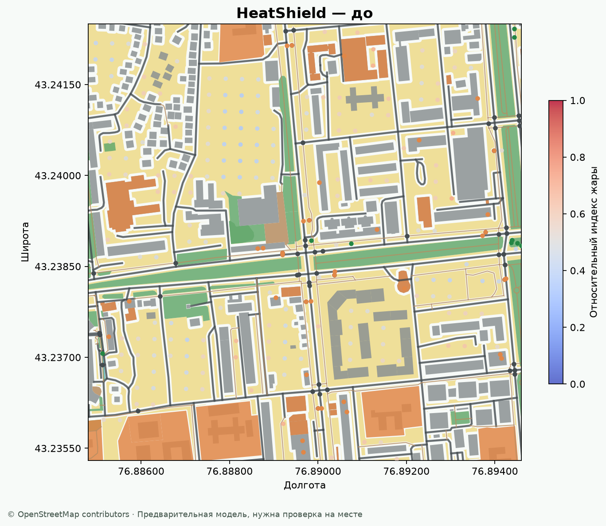
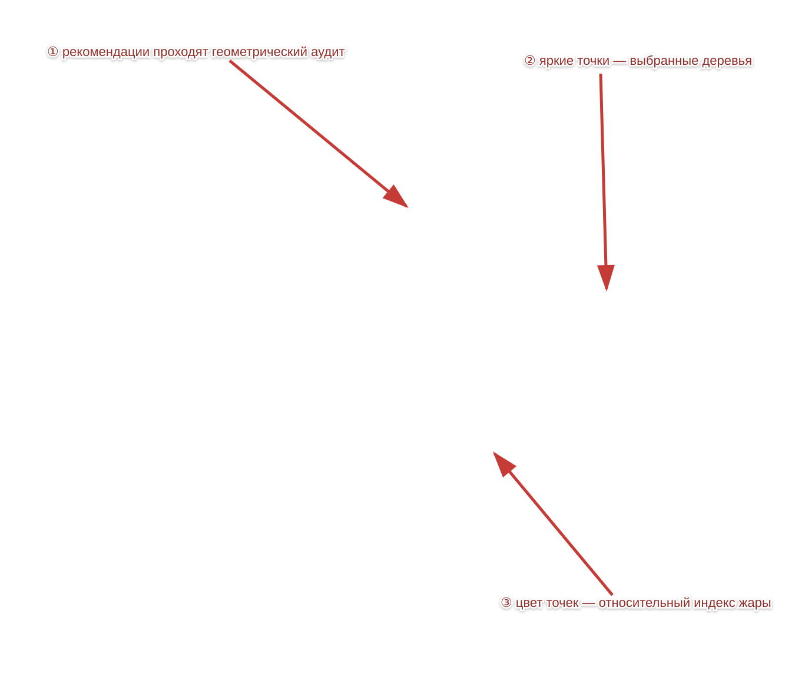

# HeatShield — двухминутный отчёт о продукте

## Что это за проект

HeatShield — настольное приложение на Python для предварительного планирования озеленения. Оно загружает реальные объекты OpenStreetMap, исключает здания, дороги, тротуары, воду, существующие деревья и запретные зоны, затем предлагает проверенные геометрией точки. На выходе пользователь получает план, карту «до/после», таблицу показателей и экспорт для GIS/Excel.

Важно: это система поддержки решения, а не обещание температуры в градусах. OSM неполон, поэтому перед посадкой нужны проверка собственности, коммуникаций, грунта и осмотр на месте.

## Как читать картинки

Исходная карта района:

Результат после выбора точек:

На второй картинке стрелками отмечены три вещи: рекомендации строятся только в свободной геометрии, зелёные точки являются выбранными деревьями, а цветовая шкала показывает относительный индекс жары, не градусы Цельсия.

## Какие проблемы были найдены и исправлены

| Проблема | Почему это было опасно | Исправление |
|---|---|---|
| Настройки можно было поменять во время сетевого анализа без явного предупреждения | На экране мог временно появиться план со старыми параметрами | Анализ теперь не сбивается; UI показывает предупреждение и автоматически повторяет оптимизацию с актуальными настройками |
| Контрольный план назывался Random | Пользователь мог принять его за ещё одну «умную» рекомендацию | В интерфейсе он называется «Контрольный», seed виден в параметрах; это воспроизводимая проверка, а не истина |
| Участок можно было только нарисовать заново | Было неудобно точно подогнать границы | После выбора появляются четыре жёлтых угла; каждый можно перетащить, границы нормализуются и проходят повторную проверку площади |
| Нулевой шаг сетки мог привести к зависанию | Ошибка входа превращалась в бесконечный перебор | Геометрический модуль сразу выдаёт понятный `ValueError` |
| Старый сценарий без новых слоёв мог падать в аудите | Обратная совместимость была непредсказуемой | Аудит использует безопасные значения по умолчанию и честно показывает предупреждения о неполных данных |

## Что проверено

- `28 passed` unit/regression тестов.
- GUI smoke-тест: WebEngine загрузился, drag дерева передал сигнал, слои включаются ожидаемо, четыре угла участка создаются.
- Сценарий Алматы: 177 кандидатов, 20 деревьев при бюджете 200 000 ₸, независимый аудит не нашёл геометрических нарушений.
- Проверен запрос на 150 деревьев при бюджете 1 500 000 ₸: алгоритм выбирает 150, если геометрия и расстояния это позволяют.
- Проверены существующие деревья, тротуары, велодорожки, парковки и локальные запретные полигоны из GeoJSON.

## Двухминутное объяснение для демонстрации

1. Выберите участок: город, Google Maps, координаты или Shift-мышь. Жёлтые углы можно подправить.
2. Запустите анализ. В фоне скачиваются OSM-данные, строится свободное пространство и независимый аудит.
3. На карте жёлтые точки — допустимые кандидаты, зелёные — выбранные деревья. Перетащите зелёное дерево: приложение привяжет его только к проверенному кандидату и перепроверит весь план.
4. Во вкладке результатов смотрите не только пользу, но и тень, площадь, индекс жары, покрытие маршрутов и предупреждения.
5. Если поменять бюджет, веса или цель во время анализа, загрузка не отменится: приложение предупредит и пересчитает итог с последними значениями.
6. Сохраните JSON, GeoJSON, CSV и PNG. Эти файлы можно передать городскому специалисту для полевой проверки.

## Честные ограничения

Индекс жары и пешеходный спрос — относительные прокси по геометрии OSM. Коэффициент отклика под кроной не обучен на локальных измерениях. Отсутствие дерева в OSM не означает, что его нет в реальности. Поэтому итоговая рекомендация — список мест для проверки, а не разрешение на посадку.
